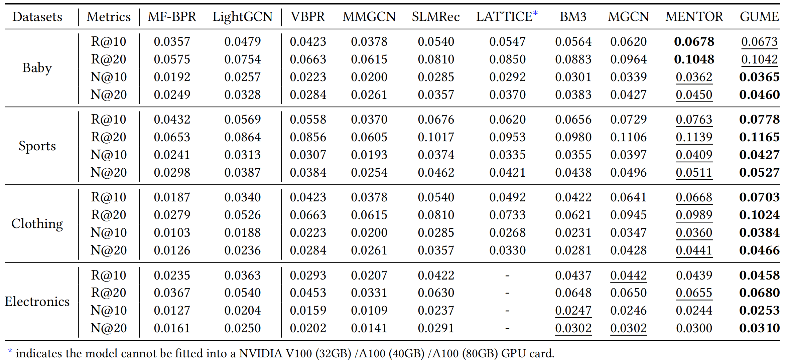

# GUME: Graphs and User Modalities Enhancement for Long-Tail Multimodal Recommendation

当前 branch_2 工作：原 AMORE 已完成初筛，接下来**从完整修正版逐项删减**。请按 [当前结果分析与执行流程](docs/AFTER_ORIGINAL_RESULTS.md) 操作；AMOREX 和之前的融合探索已停止。

<!-- PROJECT LOGO -->

## Introduction

This is the Pytorch implementation for our GUME paper:

>GUME: Graphs and User Modalities Enhancement for Long-Tail Multimodal Recommendation

## Environment Requirement
- Python 3.10 or later
- Install dependencies with `pip install -r requirements.txt`

## Dataset

We provide four processed datasets: Baby, Sports, Clothing, Electronics.

Download from Google Drive: [Baby/Sports/Clothing/Electronics](https://drive.google.com/drive/folders/1_j7du9KX30S9PwX8jmHlTmhxOof5WTnS?role=writer)

## Training
  ```
  python src/main.py --model amorelegacy --dataset baby --no-test
  ```

### TensorBoard

Each training run writes TensorBoard events under its `results/` output directory.
For example, to train GUME on the Clothing dataset:

```bash
python src/main.py -m gume -d clothing
```

Start TensorBoard on the training server:

```bash
tensorboard --logdir results --host 127.0.0.1 --port 6006
```

On your local computer, forward the port over SSH (replace `<username>` with your server login):

```bash
ssh -N -L 6006:127.0.0.1:6006 -p <ssh-port> <username>@<server-address>
```

Then open `http://localhost:6006`. Select multiple runs in the Scalars dashboard to compare their curves.

## Performance Comparison


## Citing GUME
If you find GUME useful in your research, please consider citing our [paper](https://arxiv.org/abs/2407.12338).
```
@article{lin2024gumegraphsusermodalities,
      title={GUME: Graphs and User Modalities Enhancement for Long-Tail Multimodal Recommendation}, 
      author={Guojiao Lin and Zhen Meng and Dongjie Wang and Qingqing Long and Yuanchun Zhou and Meng Xiao},
      year={2024},
      eprint={2407.12338},
      archivePrefix={arXiv},
      primaryClass={cs.IR},
      url={https://arxiv.org/abs/2407.12338}, 
}
```
The code is released for academic research use only. For commercial use, please contact [Guojiao Lin](guojiaolin37@gmail.com).

## Acknowledgement
The structure of this code is  based on [MMRec](https://github.com/enoche/MMRec). Thank for their work.

## branch_2 AMORE research experiments

Current work returns to the user's original full AMORE (`amorelegacy`) and a
conservative repaired/compact version (`amoreclean`). Previous AMOREX and fusion
directions are stopped. **No improvement is claimed.** Training selects checkpoints
and hyperparameters on validation; test evaluation occurs only after selection.

- [当前从这里开始：原 AMORE 结果分析，逐项检查亲和力与噪声损失](docs/AFTER_ORIGINAL_RESULTS.md)
- [原 AMORE 的版本对应、损失公式和复跑记录](docs/ORIGINAL_AMORE.md)
- [已停止方向：AMOREX 实验记录](docs/AMOREX_EXPERIMENTS.md)
- [上一轮 GUME＋EgoGCN＋SG-URInit 实验记录](docs/GUME_FUSION_EXPERIMENTS.md)
- [第一轮结果分析及早期备选方案](docs/NEXT_AFTER_CORE.md)
- [第一轮执行记录](docs/START_HERE.md)
- [研究依据、公式与来源](docs/AMORE_RESEARCH.md)
- [服务器运行命令与实验协议](docs/EXPERIMENTS.md)
- [论文修订工作稿](docs/PAPER_REVISION.md)

```bash
python -m unittest discover -s tests -v
python experiments/run_suite.py --variants amore_original --datasets baby --output results/31_original_baby
python experiments/run_suite.py --variants amore_original --datasets baby --output results/31_original_baby --execute --resume
```

The first suite command writes a plan only. Development suites do not evaluate the
test split; add `--test` only for a locked final comparison. Data and original papers
remain under their existing Git ignore rules.
