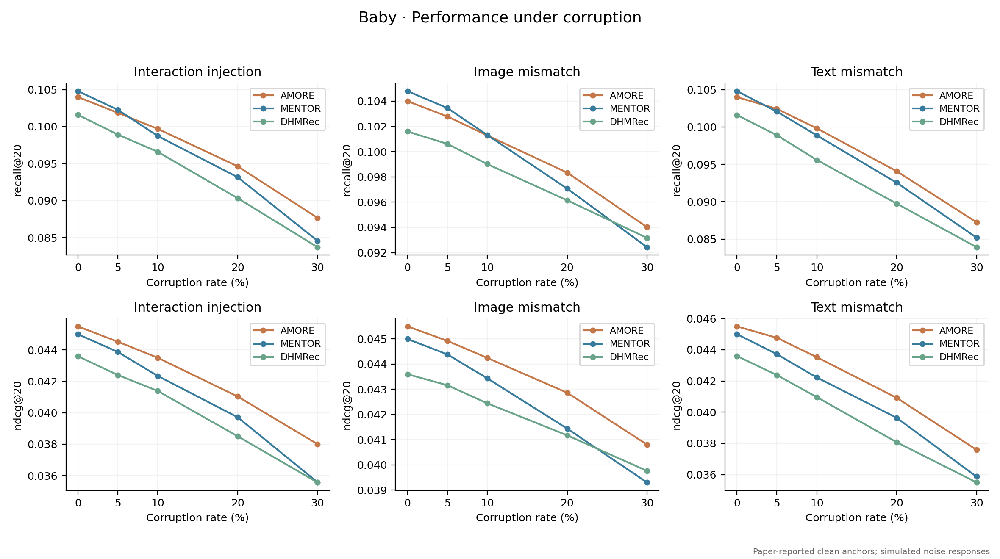
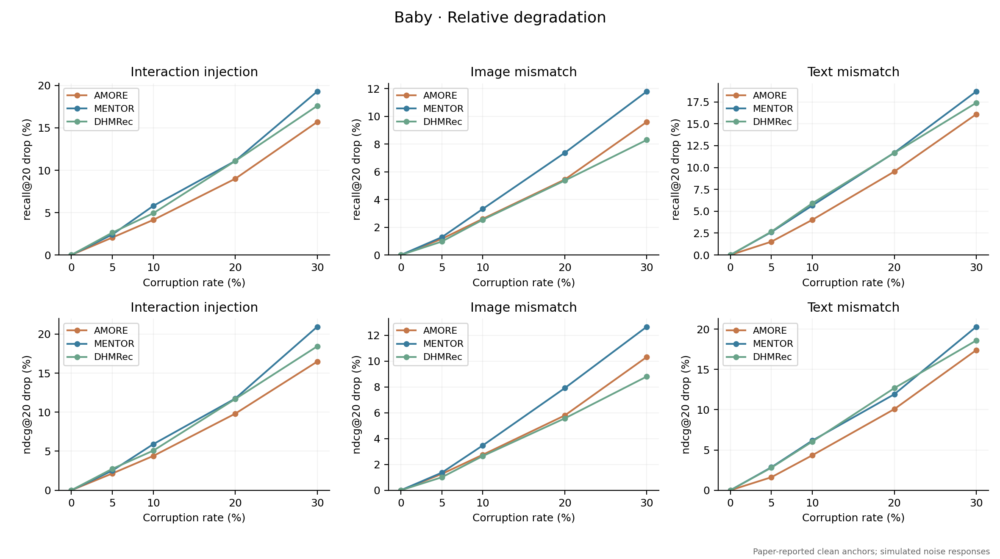
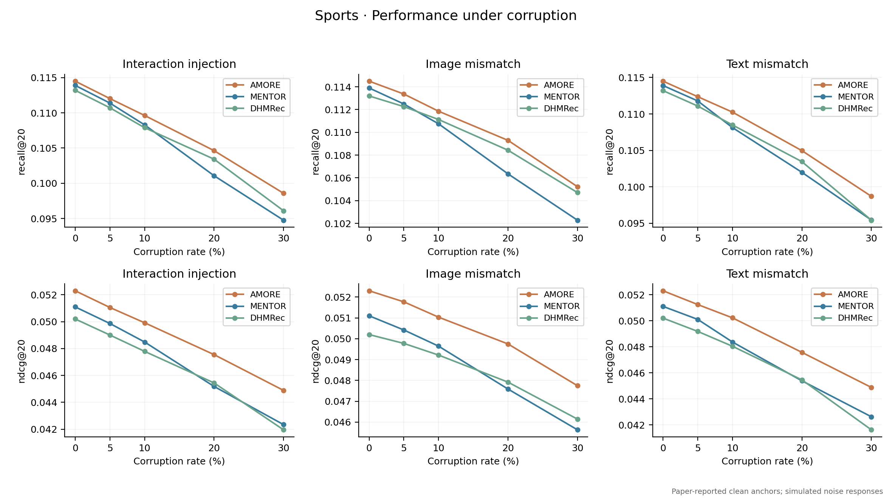
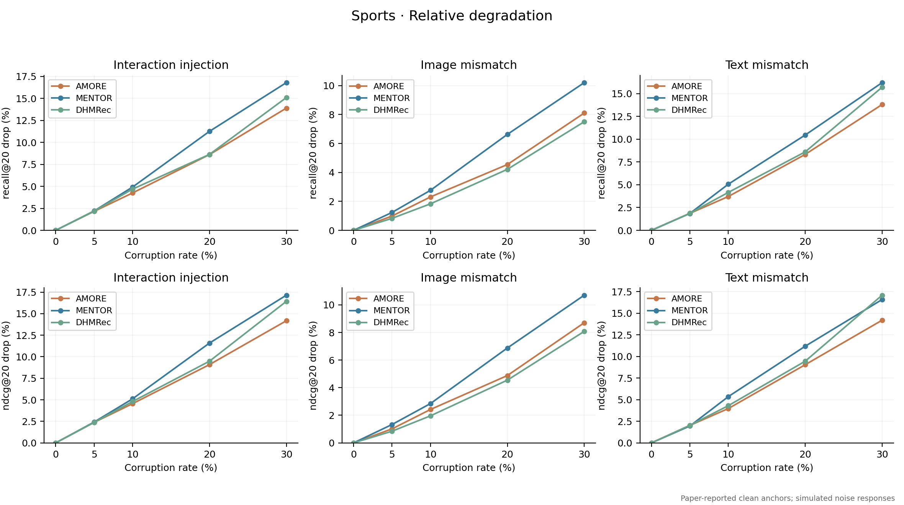
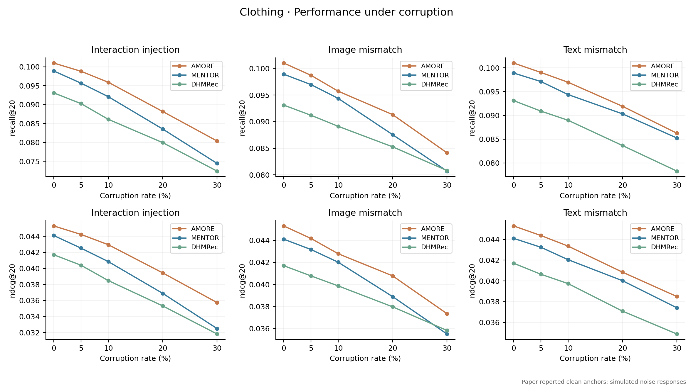
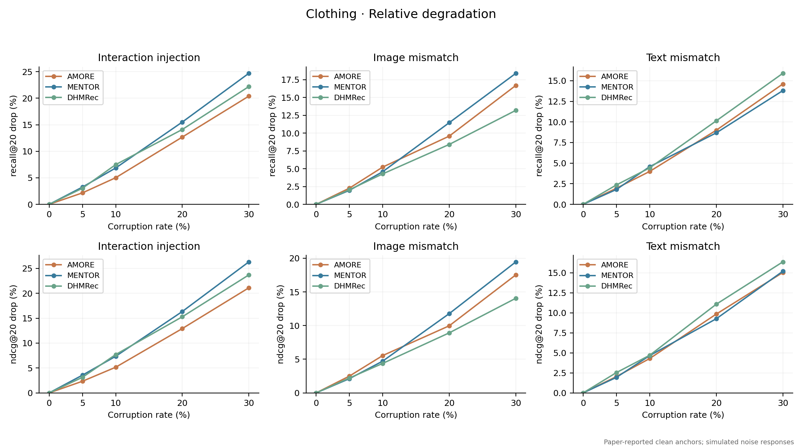

# 以论文指标为起点的噪声情景数据

0% 为来源论文报告值，其余为模拟估计点；没有附加虚构的实测标准差或显著性。

AMORE、MENTOR 起点来自 [AMORE.docx](../../papers/AMORE.docx) 表 2；DHMRec 来自 [原论文](https://ojs.aaai.org/index.php/AAAI/article/download/38661/42623) 表 1（16249 页）。这些起点来自不同论文，未核验为同协议复现结果。

## 情景定义

- 交互注入：新增伪交互数 / 原训练交互数，保留原训练边。
- 图像错配：选定比例的物品，其图像特征替换为其他物品的图像特征；文本保持原值。
- 文本错配：选定比例的物品，其文本特征替换为其他物品的文本特征；图像保持原值。
- 三种干预分别施加，设想每个强度重新训练，验证及测试交互固定。比例不是高斯噪声标准差。
- 每个点是场景指定值，不代表五种子均值。30% 下的下降范围是人为假设，没有由论文零噪声值推导出的统计保证。

## 完整数据

[noise_data.csv](noise_data.csv) 包含 135 行，四项指标 R@10、R@20、N@10、N@20，以及各自的相对下降百分比。下表展示 R@20 / N@20。

### Baby

#### 交互注入

| 噪声比例 | AMORE R@20 | AMORE N@20 | MENTOR R@20 | MENTOR N@20 | DHMRec R@20 | DHMRec N@20 |
|---|---:|---:|---:|---:|---:|---:|
| 0% | 0.104000 | 0.045500 | 0.104800 | 0.045000 | 0.101600 | 0.043600 |
| 5% | 0.101866 | 0.044523 | 0.102277 | 0.043871 | 0.098924 | 0.042404 |
| 10% | 0.099697 | 0.043501 | 0.098729 | 0.042344 | 0.096594 | 0.041388 |
| 20% | 0.094642 | 0.041036 | 0.093168 | 0.039714 | 0.090336 | 0.038505 |
| 30% | 0.087672 | 0.038004 | 0.084574 | 0.035577 | 0.083718 | 0.035564 |

#### 图像错配

| 噪声比例 | AMORE R@20 | AMORE N@20 | MENTOR R@20 | MENTOR N@20 | DHMRec R@20 | DHMRec N@20 |
|---|---:|---:|---:|---:|---:|---:|
| 0% | 0.104000 | 0.045500 | 0.104800 | 0.045000 | 0.101600 | 0.043600 |
| 5% | 0.102791 | 0.044925 | 0.103458 | 0.044387 | 0.100616 | 0.043162 |
| 10% | 0.101287 | 0.044248 | 0.101316 | 0.043437 | 0.099017 | 0.042444 |
| 20% | 0.098340 | 0.042863 | 0.097073 | 0.041439 | 0.096144 | 0.041172 |
| 30% | 0.094016 | 0.040803 | 0.092434 | 0.039300 | 0.093167 | 0.039759 |

#### 文本错配

| 噪声比例 | AMORE R@20 | AMORE N@20 | MENTOR R@20 | MENTOR N@20 | DHMRec R@20 | DHMRec N@20 |
|---|---:|---:|---:|---:|---:|---:|
| 0% | 0.104000 | 0.045500 | 0.104800 | 0.045000 | 0.101600 | 0.043600 |
| 5% | 0.102423 | 0.044766 | 0.102061 | 0.043717 | 0.098895 | 0.042380 |
| 10% | 0.099820 | 0.043525 | 0.098874 | 0.042224 | 0.095590 | 0.040965 |
| 20% | 0.094080 | 0.040919 | 0.092540 | 0.039639 | 0.089743 | 0.038072 |
| 30% | 0.087256 | 0.037585 | 0.085202 | 0.035867 | 0.083922 | 0.035494 |

### Sports

#### 交互注入

| 噪声比例 | AMORE R@20 | AMORE N@20 | MENTOR R@20 | MENTOR N@20 | DHMRec R@20 | DHMRec N@20 |
|---|---:|---:|---:|---:|---:|---:|
| 0% | 0.114500 | 0.052300 | 0.113900 | 0.051100 | 0.113200 | 0.050200 |
| 5% | 0.112028 | 0.051056 | 0.111388 | 0.049864 | 0.110720 | 0.049006 |
| 10% | 0.109628 | 0.049918 | 0.108293 | 0.048486 | 0.107892 | 0.047789 |
| 20% | 0.104636 | 0.047548 | 0.101077 | 0.045180 | 0.103425 | 0.045441 |
| 30% | 0.098584 | 0.044886 | 0.094765 | 0.042340 | 0.096107 | 0.041953 |

#### 图像错配

| 噪声比例 | AMORE R@20 | AMORE N@20 | MENTOR R@20 | MENTOR N@20 | DHMRec R@20 | DHMRec N@20 |
|---|---:|---:|---:|---:|---:|---:|
| 0% | 0.114500 | 0.052300 | 0.113900 | 0.051100 | 0.113200 | 0.050200 |
| 5% | 0.113369 | 0.051769 | 0.112494 | 0.050420 | 0.112263 | 0.049775 |
| 10% | 0.111858 | 0.051034 | 0.110752 | 0.049644 | 0.111128 | 0.049216 |
| 20% | 0.109298 | 0.049749 | 0.106353 | 0.047587 | 0.108431 | 0.047918 |
| 30% | 0.105226 | 0.047747 | 0.102282 | 0.045632 | 0.104710 | 0.046145 |

#### 文本错配

| 噪声比例 | AMORE R@20 | AMORE N@20 | MENTOR R@20 | MENTOR N@20 | DHMRec R@20 | DHMRec N@20 |
|---|---:|---:|---:|---:|---:|---:|
| 0% | 0.114500 | 0.052300 | 0.113900 | 0.051100 | 0.113200 | 0.050200 |
| 5% | 0.112367 | 0.051241 | 0.111785 | 0.050100 | 0.111084 | 0.049178 |
| 10% | 0.110250 | 0.050220 | 0.108130 | 0.048363 | 0.108489 | 0.048037 |
| 20% | 0.104962 | 0.047568 | 0.101990 | 0.045383 | 0.103456 | 0.045454 |
| 30% | 0.098699 | 0.044875 | 0.095448 | 0.042623 | 0.095428 | 0.041621 |

### Clothing

#### 交互注入

| 噪声比例 | AMORE R@20 | AMORE N@20 | MENTOR R@20 | MENTOR N@20 | DHMRec R@20 | DHMRec N@20 |
|---|---:|---:|---:|---:|---:|---:|
| 0% | 0.101000 | 0.045300 | 0.098900 | 0.044100 | 0.093100 | 0.041700 |
| 5% | 0.098819 | 0.044240 | 0.095684 | 0.042527 | 0.090275 | 0.040395 |
| 10% | 0.095929 | 0.042962 | 0.092119 | 0.040855 | 0.086127 | 0.038485 |
| 20% | 0.088197 | 0.039446 | 0.083562 | 0.036890 | 0.079965 | 0.035324 |
| 30% | 0.080396 | 0.035735 | 0.074472 | 0.032492 | 0.072432 | 0.031814 |

#### 图像错配

| 噪声比例 | AMORE R@20 | AMORE N@20 | MENTOR R@20 | MENTOR N@20 | DHMRec R@20 | DHMRec N@20 |
|---|---:|---:|---:|---:|---:|---:|
| 0% | 0.101000 | 0.045300 | 0.098900 | 0.044100 | 0.093100 | 0.041700 |
| 5% | 0.098703 | 0.044168 | 0.096956 | 0.043167 | 0.091191 | 0.040777 |
| 10% | 0.095715 | 0.042786 | 0.094367 | 0.042017 | 0.089119 | 0.039872 |
| 20% | 0.091321 | 0.040783 | 0.087554 | 0.038904 | 0.085267 | 0.037979 |
| 30% | 0.084133 | 0.037355 | 0.080702 | 0.035516 | 0.080811 | 0.035837 |

#### 文本错配

| 噪声比例 | AMORE R@20 | AMORE N@20 | MENTOR R@20 | MENTOR N@20 | DHMRec R@20 | DHMRec N@20 |
|---|---:|---:|---:|---:|---:|---:|
| 0% | 0.101000 | 0.045300 | 0.098900 | 0.044100 | 0.093100 | 0.041700 |
| 5% | 0.099026 | 0.044376 | 0.097117 | 0.043245 | 0.090907 | 0.040642 |
| 10% | 0.096966 | 0.043356 | 0.094377 | 0.042046 | 0.088977 | 0.039741 |
| 20% | 0.091917 | 0.040844 | 0.090324 | 0.040019 | 0.083665 | 0.037085 |
| 30% | 0.086254 | 0.038493 | 0.085252 | 0.037406 | 0.078297 | 0.034881 |

## 如何解读

- Baby 的零噪声 Recall@20 保留 MENTOR 高于 AMORE 的论文排序；不要把 AMORE 的起点改成第一。
- 交互注入场景假定 AMORE 相对下降较小，图像错配场景则允许 DHMRec 更耐受。
- Clothing 文本错配中，AMORE 的相对下降可以大于 MENTOR，尽管绝对指标仍可能更高。
- “分数最高”和“下降最少”必须分别判断；曲线不能归因于某个模块，模块归因还需要消融。

## 复现

`python learning_examples/paper_anchored_noise/generate.py`

仅依赖 numpy、matplotlib；CSV 使用 Python 标准库输出。相对下降按保存的六位小数值计算。
