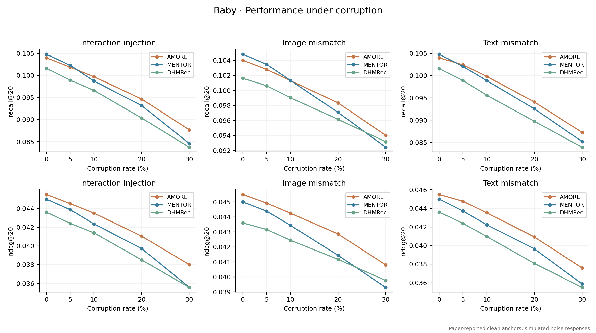
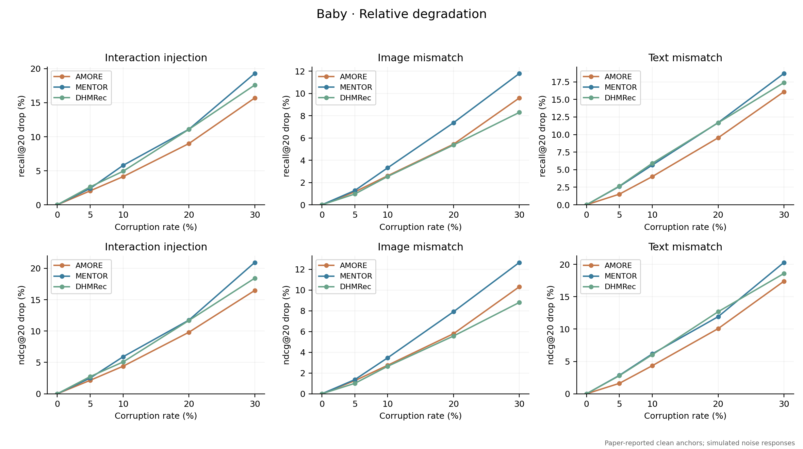
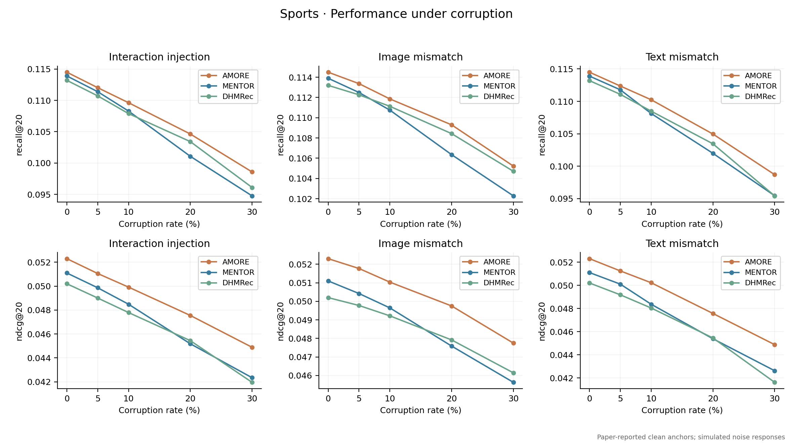
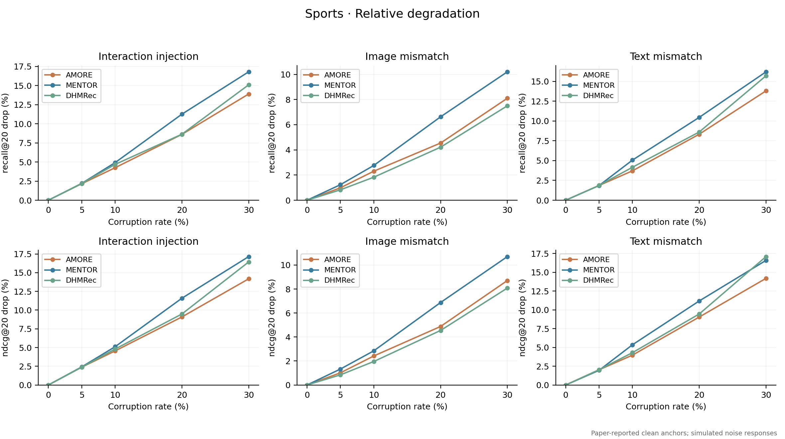
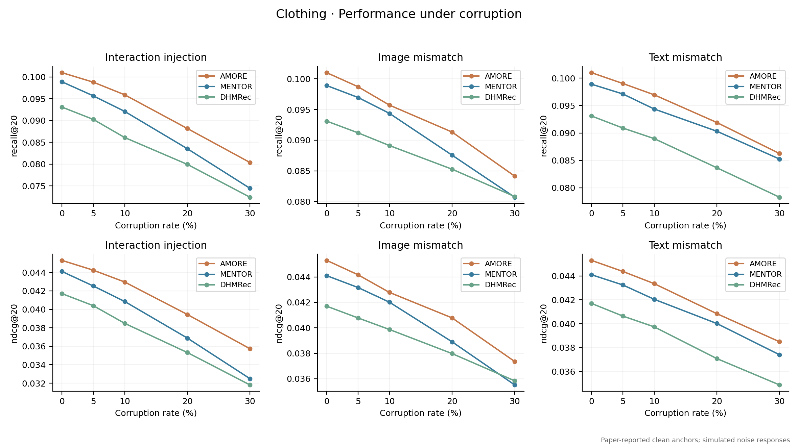
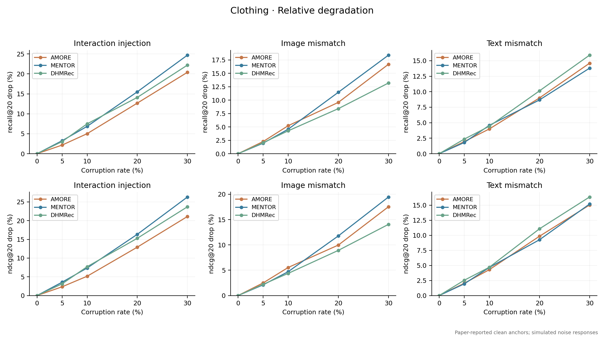

# Appendix A. Illustrative Corruption Scenarios

## A.1 Purpose and scope

This appendix illustrates how absolute ranking performance and degradation from a clean reference can lead to different interpretations. The zero-corruption anchors reproduce reported clean scores for AMORE, MENTOR, and DHMRec. All nonzero-corruption values are generated scenario values, not outcomes of retraining experiments. The curves therefore illustrate possible reporting patterns and do not establish the empirical robustness of the named methods.

## A.2 Scenario definitions and reporting quantities

Three perturbation settings are considered separately. Interaction injection represents the addition of artificial user–item interactions, with the rate defined relative to the original number of training interactions. Image mismatch represents replacing the image features of a selected proportion of items with those of other items while retaining their text features. Text mismatch applies the corresponding replacement to text features while retaining image features. The displayed rates are 0%, 5%, 10%, 20%, and 30%. These definitions specify the intended intervention; the plotted responses are constructed rather than measured under these interventions.

For a method m, corruption rate r, and metric Q, the relative decrease is defined as

**Dₘ(r) = 100 × [Qₘ(0) − Qₘ(r)] / Qₘ(0).**

Higher absolute Recall@20 or NDCG@20 is preferable, whereas a smaller Dₘ(r) indicates less degradation within a scenario. The denominator is each method's own clean score. A method can consequently retain a higher absolute score while losing a larger fraction of its initial performance. Both quantities are shown for each dataset. Relative decreases are calculated from the stored scores; the curves have no repeated-run uncertainty estimates.

## A.3 Baby

Figures A1 and A2 illustrate the distinction between the initial ranking and the assumed response to perturbation. At zero corruption, MENTOR has the higher Recall@20, 0.1048 versus 0.1040 for AMORE. In the interaction-injection scenario at 30%, AMORE's Recall@20 is 0.087672, corresponding to a 15.70% decrease, while MENTOR's is 0.084574, corresponding to a 19.30% decrease. The reversal in absolute ranking follows the specified degradation profiles; it is not an observed advantage from a corruption experiment.

The image-mismatch setting provides a different pattern. At 30%, AMORE has the higher absolute Recall@20, 0.094016 versus 0.093167 for DHMRec. Nevertheless, DHMRec has the smaller relative decrease, 8.30% versus 9.60%. Thus, the method with the highest corrupted score need not be the method with the smallest loss from its clean reference.

**Figure A1.** Illustrative absolute performance on Baby. Columns represent interaction injection, image mismatch, and text mismatch; rows show Recall@20 and NDCG@20. Zero-corruption points are reported clean scores, and nonzero points are constructed scenario values.

**Figure A2.** Relative decreases for the Baby scenarios in Figure A1, calculated against each method's own clean score. Lower values indicate less degradation within the constructed scenario; the curves do not include uncertainty estimates.

## A.4 Sports

Figures A3 and A4 show another case in which a higher absolute score and a smaller relative decrease identify different methods. Under 30% image mismatch, AMORE has Recall@20 of 0.105226, compared with 0.104710 for DHMRec. The corresponding relative decreases are approximately 8.10% and 7.50%, respectively. AMORE's higher starting score allows it to remain ahead in absolute performance even with the larger fractional decrease.

The interaction-injection and text-mismatch scenarios assign different response profiles. These differences illustrate why each perturbation should be reported separately rather than summarized as a single, universal robustness property. They cannot identify which architectural component would produce such a response in an actual experiment.

**Figure A3.** Illustrative absolute performance on Sports under three separate corruption scenarios. Rows show Recall@20 and NDCG@20. Zero-corruption points are reported clean scores, and nonzero points are constructed scenario values.

**Figure A4.** Relative decreases for the Sports scenarios in Figure A3. Each curve is normalized by its own clean reference. The image-mismatch example illustrates that the highest absolute score can coexist with a larger relative decrease.

## A.5 Clothing

Figures A5 and A6 include a metric-specific reversal in the relative-degradation comparison. Under 30% text mismatch, AMORE retains a higher absolute Recall@20 than MENTOR, 0.086254 versus 0.085252. However, its relative Recall@20 decrease is larger: 14.60% versus approximately 13.80%. A statement that AMORE degrades less would therefore be incorrect for this setting, even though its absolute score is higher.

The corresponding NDCG@20 decreases are approximately 15.03% for AMORE and 15.18% for MENTOR. The relative ordering therefore differs between Recall@20 and NDCG@20, with a small difference in the latter metric. This example illustrates the need to qualify comparisons by dataset, perturbation type, rate, and evaluation metric.

**Figure A5.** Illustrative absolute performance on Clothing. Columns represent interaction injection, image mismatch, and text mismatch; rows show Recall@20 and NDCG@20. Zero-corruption points are reported clean scores, and nonzero points are constructed scenario values.

**Figure A6.** Relative decreases for the Clothing scenarios in Figure A5. At 30% text mismatch, AMORE has a larger relative Recall@20 decrease than MENTOR despite its higher absolute score; the corresponding NDCG@20 comparison has a different ordering.

## A.6 Interpretation limits

The endpoint decreases and intermediate response profiles are assumptions of the scenario generator. The apparent trends and crossings therefore follow from that construction and are not evidence of noise detection, shared-prior efficacy, or a particular module's causal contribution. Empirical evaluation requires measured results under a matched corruption and training protocol, with both absolute scores and within-method degradation reported. The figures illustrate this reporting distinction while leaving the empirical robustness question open.
